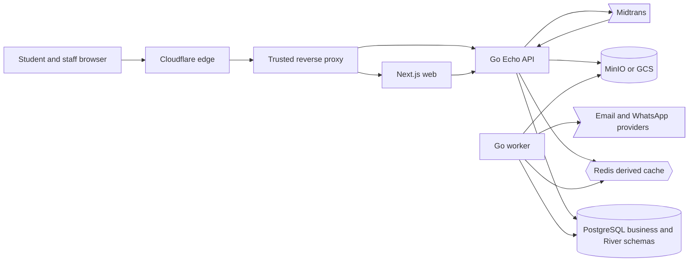
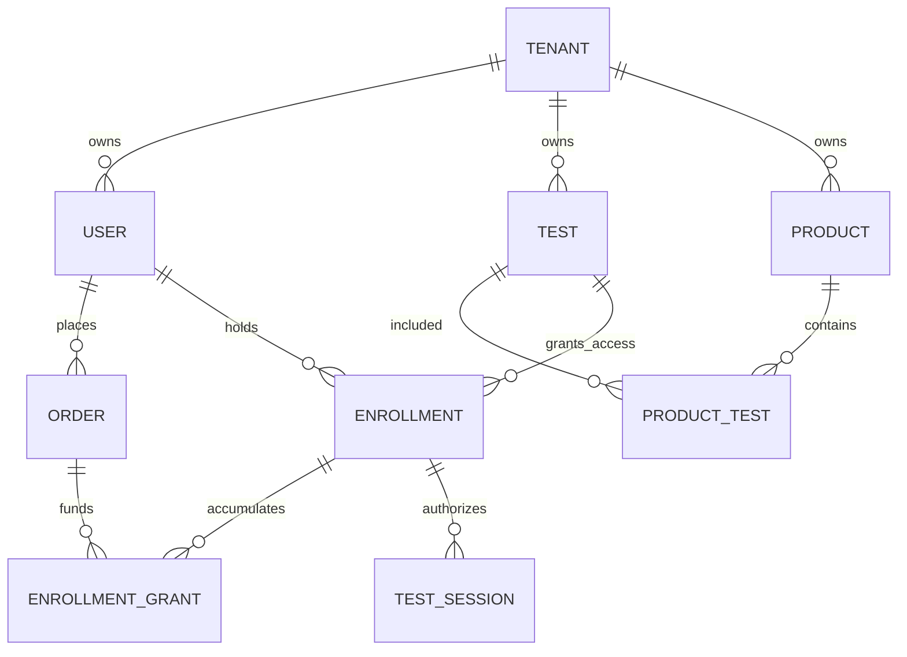
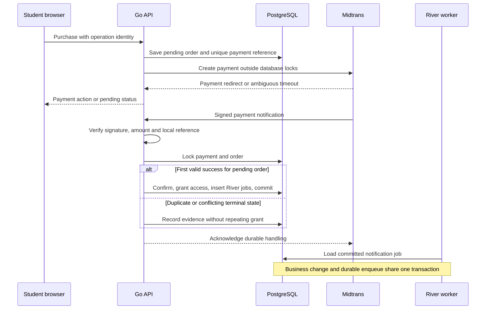
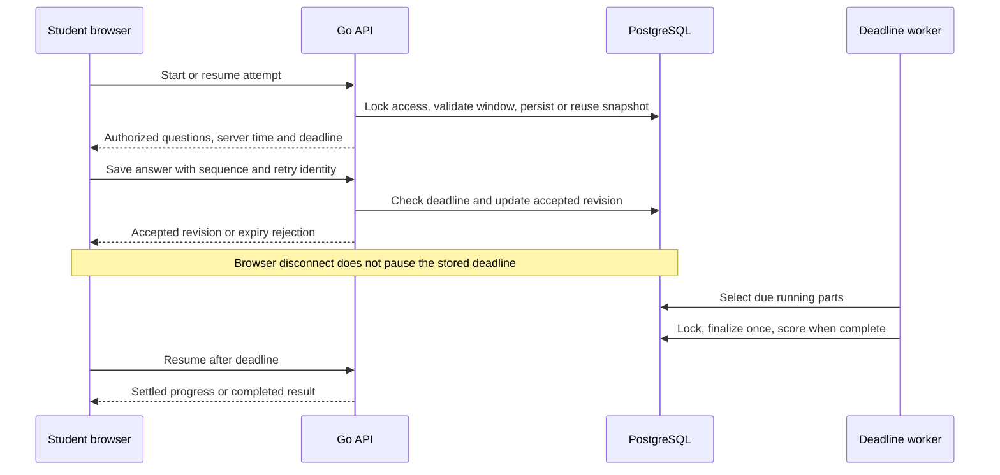

# Taruna Eduka — Full-scope System Architecture

## 1. Context & Background

This design translates [PRD v1.3](PRD.md) into a target system and replaces the architectural assumptions in delivery plan v1.0. It covers **all 161 numbered functional requirements**, the four question types, scoring rules, and PRD §6 operational requirements. [Reconciliation and traceability](RECONCILIATION.md) records conflicts and maps requirements to [delivery slices](PLAN.md).

The source baseline is Git `4f2246a`, inspected on 2026-10-08 and refreshed on 2026-10-09. `web/` contains 35 Next.js pages, mostly backed by mock data/localStorage. `api/` is a Go walking skeleton with users/programs, health probes, and a demo-identity `/api/v1/me`. No live production deployment, production data, or actual capacity has been established by this review.

**Document status:** this is a complete architecture proposal for review, not a claim that features exist or that business policies have been approved. PRD requirements are distinguished from proposed implementation choices. Decisions D01–D17 in §9 remain explicit gates for affected implementation/release work. The PRD itself is preserved unchanged.

**MVP tenancy override (D17, 2026-10-28):** multi-tenancy is deferred out of MVP. MVP runs as one platform with one configured tenant on one domain. The `tenant_id` columns and scoped repositories stay as built, so tenancy can return later without a schema rewrite. Sections below that describe subdomains, Platform Admin, master content, support context or cross-tenant reporting are the post-MVP target, not MVP scope. No application implementation is authorized by this documentation task.

## 2. Goals & Non-Goals

### Goals

- One installation serves one tenant (D17) on a schema that keeps `tenant_id` scoping for a later multi-tenant release.
- Students register, purchase through gateway/manual/wallet, complete repeatable tryouts or metered kecermatan attempts, and review their history.
- Staff manage content and operations.
- Financial/session invariants hold under retries, concurrent requests, crashes, stale caches, and direct API access.
- Meet the PRD targets: 10,000 registered users and 1,000 aggregate CCU; non-exam API p95 ≤500ms; question load ≤1s; expiry submission tolerance ±5s; availability 99.5%; daily backups retained 30 days.

### Non-Goals

Multi-tenancy in MVP (D17): subdomain resolution, tenant provisioning/pausing, Platform Admin, master content and copy-to-own, support context and cross-tenant reports. No live classes, native mobile application, national ranking, scheduled competition, automated revenue-share settlement, per-tenant merchant credentials, advanced predictive analytics, or student PDF downloads. Kecermatan PDF is an open scope question, not an approved feature. Full scope means everything currently required by PRD v1.3, including the expanded kecermatan/item-package requirements, not its separately listed post-MVP roadmap.

## 3. High-Level Architecture

**Proposed baseline: one Go application with domain-focused service files, deployed as API and worker processes, plus one Next.js application.** PostgreSQL owns business state and durable River jobs. Redis holds rebuildable data. MinIO locally/GCS in production holds assets. Cloudflare is the DNS/TLS/CDN edge; application compute remains self-hosted. No microservice split, Kafka, or extra database is needed for this design.



| Component | Responsibility | Boundary |
|---|---|---|
| Next.js | Tenant/platform landing, catalog, student/admin/platform portals, forms, timer display, math rendering | No payment, scoring, quota, or authorization decisions in the browser |
| Echo handlers + middleware | Resolve trusted host, authenticate, authorize, validate transport, serialize responses | No client-selected tenant or role trusted |
| Go services | Transactions, enrollment issuance, wallet operations, content freezing, session transitions, scoring | Business rules live here; preserve existing model/repository/service/handler layout |
| Repositories | Raw SQL, mandatory scope, persistence and locking | Tenant repositories require scope; cross-tenant platform reporting is a separate explicit entry point |
| Worker | Notifications, imports, PDFs, spreadsheet exports, deadline enforcement/recovery | Jobs carry immutable entity IDs and tenant/actor context; re-check scope before loading objects |
| PostgreSQL | Authoritative identities, catalog, finance, access, answers, snapshots, results, audit, durable jobs | One database, shared schema with `tenant_id`; `river` is a separate schema, not a separate datastore |
| Redis | Versioned pre-shuffle content, tenant-local ranking projections, and auth throttle counters (P03b) | Loss never loses money, answers, jobs, or sessions; a lost throttle counter only resets a budget early |
| Object storage | Validated public branding assets and protected exam/payment/export assets | Object identifiers are authorized through the API; URLs are not proof of permission |

### Routing and deployment

**MVP (D17):** one domain serves the landing, catalog and portals. The API takes the tenant from configuration, not from the request host, and no tenant host or platform admin host exists. The rest of this section is the post-MVP target.

The PRD target is root `tarunaeduka.id` for platform marketing and `<slug>.tarunaeduka.id` for tenant landing/catalog/portals. A proposed reserved `admin.tarunaeduka.id` hosts Platform Admin. The exact production names, first Taruna tenant slug, and DNS ownership remain D06. Use one Next.js build with host-dependent rendering, rather than the old plan's separate landing deployment.

Route `/api/v1/*` on each tenant host to Echo at the trusted origin proxy. Browser calls are same-origin; Next.js server-side calls use an internal API address while propagating host only through a trusted proxy contract. A fixed platform-owned webhook route accepts Midtrans notifications and resolves tenant from a stored payment reference, not the request host or a supplied tenant ID. Origin access is restricted; strip untrusted forwarding headers before setting canonical host metadata.

Host parsing removes an allowed port in local development, normalizes case, validates the expected suffix and single slug label, and looks up an active tenant. Unknown/reserved names never fall back to a default tenant. Local tests use at least two explicit host mappings; production never uses demo identities. Cloudflare DNS and edge certificates are distinct from compute and origin TLS; validate both in staging. [Cloudflare certificate coverage](https://developers.cloudflare.com/ssl/edge-certificates/universal-ssl/)

Same application images run across replicas. Tenant pages initially render dynamically without shared HTML/data caching. Only explicitly public assets are CDN-cacheable; authenticated responses and all exam content use `Cache-Control: private, no-store`. Any later public-page caching must key on tenant/host and content version, including Next.js internal caches. [Next.js self-hosting considerations](https://nextjs.org/docs/app/guides/self-hosting)

## 4. Detailed Design

### 4.1 Tenant and identity

**MVP (D17):** the chain is **configured tenant → JWT/session → token tenant match → role → resource ownership**. Every account belongs to the configured tenant, so identifier uniqueness is effectively global. Platform Admin and support context are post-MVP; the roles in MVP are Student, Operator and Admin.

The authorization chain is **validated host → active tenant → JWT/session → token tenant match → role → resource ownership**. Resolve it on every API request; a frontend role guard is presentation only. JWT includes subject, role, tenant identity, expiry, and server-session linkage. Proposed short-lived access JWT in browser memory plus a rotating, hashed server-side refresh session with a Secure/HttpOnly host-only cookie. Validate issuer/audience and revoke refresh sessions on logout/deactivation; exact lifetimes/idle policy are D13. Origin/CSRF protection applies to cookie-authenticated mutations. No wildcard-domain refresh cookie.

Tenant users have non-null tenant IDs; only Platform Admin has a null tenant ID. Unique email/phone is per tenant with separately enforced platform-account uniqueness. Registration/login looks up identifiers only within the resolved tenant. Passwords use bcrypt; reset tokens are hashed, expiring, and single-use. Account deletion must not cascade away orders, ledger entries, or historical results: proposed deactivation/tombstoning is D14.

The original plan explicitly records an owner decision to use OTP, while PRD §7 says no OTP. Retain OTP in the draft delivery scope and flag D01; do not quietly remove it. An email-only OTP channel does not satisfy phone-only registration or phone-only account recovery; those cases need an explicit D01 decision. Notification transport is introduced before auth so there is no S1↔S2 cycle.

| Capability | Student | Operator | Tenant Admin | Platform Admin |
|---|---|---|---|---|
| Own purchases, answers, results, wallet | Own records | No student impersonation | No student impersonation | Support context is audited; identity is preserved |
| Tenant questions/tests/products/orders/results | No | Yes | Yes | Yes in explicit support context |
| Tenant program mutations, user-role management, settings | No | No | Yes | Yes in support context |
| Student CRUD | No | Yes (D02: FR-ADM-STU-01 wins over §4 for student accounts only) | Yes | Yes in support context |
| Item-package mutations | No | Yes (D02: the section title wins over the body) | Yes | Master or explicit support context |
| Tenant provisioning, master mutations, global reports | No | No | No | Yes |

Platform support uses a short-lived scoped context tied to the actual Platform Admin principal. Never mint a student token or overwrite the audit actor. A paused tenant blocks tenant users and public content but remains accessible to authenticated platform support. D15 governs background financial events already in flight while a tenant is paused.

### 4.2 Data ownership and schema

Use the PRD unified `tests`, `enrollments`, `test_sessions`, and `product_tests`; retain separate tryout/kecermatan answer/result tables. The following are **target schema additions**, not existing tables or finalized migration DDL.

| Domain | Entities | Ownership / important constraints |
|---|---|---|
| Tenancy | `tenants`, `tenant_settings`, `audit_logs` | Unique immutable validated slug; settings/branding and activity state; immutable actor and support-context audit |
| Identity | `users`, `auth_sessions`, `password_reset_tokens`, conditional `otp_codes` | User-role/null-tenant consistency; tenant email/phone uniqueness; platform partial indexes; hashed secrets |
| Shared curriculum | `programs`, `program_subjects`, `subject_chapters` | Master or tenant ownership inherited consistently throughout tree; used parents cannot be deleted |
| Questions | `questions`, proposed immutable `question_versions` | Four types; answer keys, option IDs/points, difficulty and explanations; copies retain source lineage, never live synchronization |
| Kecermatan items | `item_packages`, proposed `item_package_versions`, asset references | Include **emoji** as well as symbol/image/shape, fixing PRD §8 omission; master or tenant |
| Tests | `tests`, `tryout_details`, `subtests`, `subtest_questions`, `kecermatan_details`, `kecermatan_test_packages` | Always tenant-owned; assigned question/package versions cannot change under an existing test/session |
| Commerce | `products`, `product_tests`, `orders`, proposed `payment_attempts`/`payment_events` | Tenant ownership; server price and immutable purchase snapshot; merchant reference globally unique across orders and top-ups |
| Wallet | `topup_requests`, `wallet_transactions`, user balance projection | Fixed-precision money, signed movements, balance-after, typed actor and business-source uniqueness |
| Access | `enrollments`, proposed `enrollment_grants` | One user/test aggregate; distinct source grants preserve order/manual provenance and repeat purchases; metered attempt increments are idempotent |
| Runtime | `test_sessions`, proposed `session_parts`, typed answers, `violations` | One active attempt per user/test; atomic attempt-number allocation; server deadlines; stable content snapshots |
| Results | Typed result tables, proposed student/test aggregate | One result per session; versioned scoring config; sum/count/average for leaderboard projection |
| Async/artifacts | `notification_logs`, `question_exports`, proposed `result_exports`/`import_batches`, River tables | Tenant/actor-scoped requests, immutable input revision, status, private asset reference, recoverable failure |

Operational roots always carry `tenant_id`. Child tables whose tenant is inherited (answers/violations, curriculum children) are reachable only through an already scoped parent; do not expose an unscoped child lookup. Enforce composite tenant foreign keys on operational roots where possible. Master-or-own references cannot be protected by a naive `(tenant_id,id)` FK because master ownership is null: validate visibility and type inside the transaction, plus referential foreign keys. Null tenancy is not a general authorization bypass. [PostgreSQL constraint semantics](https://www.postgresql.org/docs/current/ddl-constraints.html)

Index tenant-first list/filter paths, unique purchase/enrollment grant sources, `(tenant_id,user_id,test_id,attempt_number)`, answer natural keys, active-session/deadline lookups, and per-test result aggregates. Use a partial uniqueness constraint for a single in-progress session. Partial platform indexes cover non-null email and phone when tenant is null. Do not use float64 for the money write path: exact numeric arithmetic and canonical decimal transport are proposed; merchant precision/rounding is D12.



### 4.3 Curriculum, question bank, and immutable content

Admin manages Program → Subject → Chapter; students/staff can read authorized master-plus-own selections. Operators cannot mutate programs. Master content is read-only to tenants, tagged by origin, and copied into tenant ownership on explicit duplication. A tenant question may use an authorized master program/subject; it may never reference another tenant's tree.

Persist explicit option IDs: points and correct-answer membership refer to IDs, not shuffled positions. Support `pg`, all-or-nothing `pg_multi`, configurable exact/case-insensitive `isian`, and `benar_salah`. Weighted-option mode is only for `pg`; every option has a point value, default 1, and blank answers do not earn default points. Difficulty weights and normalization are D04. LaTeX and validated images render in the editor, student view, and PDF.

At question assignment, freeze the referenced question version, including scoring and explanation content. A master update creates a new revision; an existing assignment and a copied question remain unchanged. Test edit/delete locks begin with the first session, including all builder fields as in the old plan. Freeze item-package contents for published kecermatan definitions/sessions as well, so package edits cannot alter historical attempts.

Question import accepts XLSX/CSV/DOCX templates, validates file-derived content, and shows actual row-level results before commit. D08 resolves the old plan's contradictory all-or-nothing/valid-row import rule. Commit selected validated rows atomically under an import identity; retries do not duplicate questions. Keep spreadsheet formulas as text when importing/exporting user-controlled content.

### 4.4 Assets and item packages

The API owns asset authorization and finalization. Branding/cover assets may be public; payment proofs, unreleased content, answer-key snapshots, and exports are private. Persist object keys, not long-lived signed URLs. Re-authorize downloads and issue short-lived access after tenant/role checks. Signed URLs grant access to whoever holds them until expiry; they do not themselves enforce the current logged-in tenant. [GCS signed URLs](https://docs.cloud.google.com/storage/docs/access-control/signed-urls)

Validate decoded file type and byte size, not extension alone. Enforce 5MB per image, PNG/JPG/WebP package images, and reject SVG in item packages. For symbol CSV/TXT/XLSX or multi-image/ZIP imports, stage uploads and parsed elements as temporary preview data; confirmation commits accepted elements only. A crashed/rejected preview does not mutate the package; clean up abandoned staged assets.

ZIP input ≤10MB; reject traversal, absolute paths, nested ZIPs, symlinks, unsupported images, corrupted files, and excessive decoded image dimensions. Bound extraction size and file count before processing; exact limits are D09. Compare image content hashes and canonical symbol elements for duplicate rejection. Package delete/shrink is rejected if any referencing test would lose its required pool size; frozen assets stay available to existing sessions.

Support built-in A–Z, 0–9, seven shapes; editable symbol/image packages; optional shape subsets; emoji subsets chosen from a system catalog. Emoji uses one-codepoint stable system IDs and bundled licensed assets/font, never device emoji or free-text uploads. Reject emoji in symbol packages with guidance. `mix` combines selected built-in sources/packages and deduplicates across sources. Preview one generated column without persisting an attempt.

### 4.5 Catalog, purchases, wallet, and grants

Every product/test/order belongs to a tenant. Individual = one tryout; bundle = selected tryouts; kecermatan = one kecermatan test with positive included attempts. Server validates product activity, tenant, authorized test links, dates, and price before ordering. Store product title/price/test membership/access snapshot at checkout; a later product edit cannot rewrite what was bought. Landing/catalog reads only tenant-authorized active products and branding; no production fallback to demo data.

Wallet payments lock the user's wallet projection, check sufficient funds, write the debit and new balance, confirm the order, grant access, and enqueue notification jobs **in one PostgreSQL transaction**. A rollback changes none of these. All money movements use the same service and lock order. Ledger signed deltas sum to the balance projection; an opening-balance ledger entry accounts for any explicitly migrated starting balance. Admin/operator adjustments require an explanation and preserve actual actor identity. D12 defines negative-balance and monetary precision policy.

Top-up requests are separate from product orders. Manual requests remain pending until authorized review; rejection records reason without credit. Gateway top-ups credit only after verified success. Store student/gateway/staff actor kind and relevant identity: nullable actor alone cannot distinguish those paths. Duplicate reviews/events produce one ledger credit. Per-tenant minimum is validated server-side. Wallet history returns running balance and business references.

Enrollment issuance is one shared service invoked by wallet, verified gateway, manual confirmation, and explicit audited staff grants. Multiple kecermatan purchases create separate payment records but add credit to the **same user/test enrollment**; each order line grants once. This reconciles the PRD phrase "not a separate transaction" as quota aggregation, not erasing the financial audit trail. Tryout repeat-purchase expiry overlap policy is D05. Grants without an order retain actor and reason.

Gateway transaction creation is an external side effect, not part of a database transaction. Commit a unique local payment attempt/reference first; call Midtrans outside locks; persist the response; query status on ambiguous timeout before retrying with the same identity. Do not create another payment to resolve an uncertain first response.

Webhook verification uses Midtrans's signature rule and amount/reference match. Success is settlement, or qualifying card capture with accepted fraud status; pending/challenge/deny/expiry is not proof of success. Never trust a browser return URL. Tenant comes from the local payment reference. Notification authentication, status handling, and retry behavior must follow [Midtrans's notification contract](https://docs.midtrans.com/docs/https-notification-webhooks).

| Business state | Allowed trigger | Result |
|---|---|---|
| Order pending | Wallet debit, approved manual review, verified gateway success | Confirmed + grant + durable notifications once |
| Order pending | Authorized cancellation | Cancelled; no grant |
| Order confirmed | Duplicate/stale gateway or staff request | No repeat grant/debit; never downgrade to pending |
| Order cancelled | Late successful payment | Record the verified payment; queue reconciliation; D07 governs refund/access decision |
| Top-up pending | Manual approval or verified gateway success | Approved + one credit |
| Top-up pending | Manual rejection | Rejected + reason; zero credit |
| Any terminal top-up | Duplicate or contradictory event | Keep evidence, no repeated money movement; D07 governs exception policy |

Request idempotency is scoped by tenant, actor, operation, and client operation identity with payload consistency. Database unique business-source constraints remain the last guard even if an idempotency response cache is lost. Provider reconciliation is recorded separately from the PRD's simple order states; no automatic refund feature is silently added.



### 4.6 Tryout runtime

Starting an attempt validates active tenant, user ownership, enrollment, and test window, then atomically returns the existing in-progress session or allocates the next attempt number. Concurrent starts cannot create two active sessions. Freeze all assigned content/scoring versions and persist one permutation per session; answers reference stable question/option IDs. Retried start/resume returns the same snapshot. Separate attempts receive independently generated permutations; identical random permutations remain mathematically possible, so tests use controlled seeds rather than asserting all real attempts must differ.

Persist each subtest's status, start time, absolute server deadline, and submission time. The first subtest starts on explicit student action; later subtests start only through a validated transition. Server time governs admission of every answer and submission. The browser derives its display from server time plus monotonic elapsed time and re-syncs on focus/resume; device wall-clock changes do not extend the server deadline.

Persist accepted answers incrementally with a version/sequence and idempotent retry identity. Reject stale reordered writes so an older retry cannot overwrite a newer answer. The browser may retain unsent answers locally, but shows accepted/pending state and never claims an offline answer is saved. Late-arriving answers cannot be backdated from an untrusted client timestamp; any grace/compensation policy is D10.

An independent deadline worker finds due in-progress parts from PostgreSQL and finalizes idempotently, whether the tab is active, closed, or disconnected. A small indexed due scan plus durable work recovery is proposed; scheduled jobs are accelerators, not the only source of expired sessions. The answer path also enforces expiry synchronously. The PRD ±5s requirement applies to visible auto-finalization under normal operation and is a load/recovery release gate; correctness never allows answers beyond the deadline merely because a worker is late. Worker downtime is alerted and measured, not treated as meeting the tolerance.

| Session/part | Transition | Invariant |
|---|---|---|
| No active session | Authorized start | One in-progress session, stable attempt number and snapshot |
| Current unstarted part | Explicit start | Set start/deadline once; prior parts must be submitted |
| Current running part | Answer | Owner/tenant/current-part check, before deadline, monotonic answer revision |
| Running part | Submit or expiry | Immutable submitted state; retries return the settled state |
| Submitted part | Open/write by direct URL/API | Rejected; cannot move backward |
| Last submitted part | Finalize | Exactly one persisted result and completion event |

Window precedence (test deadline versus enrollment expiry versus subtest deadline) and whether an admitted attempt may finish after access expiry remain D10. Persist effective deadlines after that decision; do not silently extend access. Fullscreen entry is user-gesture-driven with browser capability detection. Exits and detectable screenshot shortcuts append server-received violation events, show a warning, and never stop the timer. These controls are best-effort deterrents; they cannot prevent all OS screenshots. No violation log is generated for kecermatan.



### 4.7 Kecermatan runtime and scoring

Builder enforces even `kolom_count ≥10`, `soal_per_kolom ≥50` (default 50), `item_length` from 1 through 5, positive duration, and a feasible reference option count. After source deduplication, pool size must be at least `options_per_soal × item_length`. The upper bounds for option count/session size and automatic transition interval are D09/D10.

At attempt admission, atomically check for a remaining credit and create the session. A duplicate start returns the same session. Admission requires a remaining credit but does not consume it; the credit is consumed only when the attempt completes (D05), so an abandoned or unsubmitted expired attempt costs nothing. Payment increments and completion decrements serialize on the same enrollment row.

Generate the first N/2 columns from versioned authorized sources on the server. Sample elements without replacement within a column: no duplicate element inside an item or across reference items. For each question choose one missing reference item and shuffle the others. Save the entire generated question order, reference set, visible subset order, and scoring key once. The second half points to the **same content snapshots**, with distinct timing/answer rows. Column k and k+N/2 are identical in content; do not mark the repetition in student UI.

Only expose the authorized current reference set/subset and display metadata; never expose `missing_label`, correctness, future-column snapshots, or answer keys before review is permitted. The reference set itself must be visible when solving the question, correcting the old plan's impossible blanket prohibition. This is a solvable visual puzzle, not a secret protected by hiding reference items.

A column has one shared server deadline. Submit/expiry records unattempted questions as kosong, distinct from wrong answers. Completion leads to a transition interval with "Continue" and automatic continuation; resume cannot reset the transition or column timer. D10 settles whether the transition advances automatically with a closed tab. No fullscreen enforcement, violations, or ranking. History preserves attempt content for detailed reference/subset/missing-item/answer review.

Counts and raw scoring inputs are always persisted. PRD §10 supplies a **provisional**, not approved, scoring formula:

- Attempted = Benar + Salah; total = all configured questions.
- Kecepatan = `(attempted / total − 0.05) × 100`.
- Ketelitian = `(Benar / attempted) × 100`.
- Ketahanan = `(mean Benar last five columns / mean Benar first five columns − 0.05) × 100`.
- Nilai Akhir = `0.30 × Kecepatan + 0.45 × Ketelitian + 0.25 × Ketahanan`.

For N>10, first/last five do not compare the same repeated material. The baseline can also divide by zero or exceed the promised 0–100 range. **D03 requires client confirmation of the N>10 rule, zero-denominator behavior, clipping/rounding, and correction factor.** Proposed whole-half comparison is a recommendation, not an approved replacement. Retain scoring version and raw counts; a policy change does not silently rewrite old results. A staging provisional label does not satisfy the full-scope scoring release gate.

### 4.8 Tryout scoring, results, monitoring, and reporting

Tryout finalization computes and persists a result before responding with completion; a delayed export/notification worker cannot delay basic score visibility. Weighted scoring sums correct-answer difficulty weights; per-option questions use selected option points. Store raw earned/max scores and explicit scoring version; percentage display, global-versus-tenant weight ownership, and ties are D04. IRT mode continues to use weighted scoring with a prevalidation flag, **not a fitted IRT model**. D04 clarifies distinct-student response counting and question-version scope for the threshold of 30.

Maintain per-user/test completed-score sum, count, and average transactionally alongside one result per session. Ranking is within tenant and test, based on average of all completed attempts: 60/80/100 →80. Persisted result rank, if retained, is a historical observation; the current leaderboard is a separate query. Never use the demo's estimated rank formula. Redis sorted sets are projections keyed by tenant/test and result revision; fallback to authoritative PostgreSQL if unavailable/missing/stale. Loss of an in-process cache event cannot permanently corrupt the leaderboard. Use on-demand rebuild/version checking before trusting cached values.

Student review checks owner and session completion. Before `explanation_release_at`, the API omits restricted explanation/answer-key fields, including any asset link that would reveal them; the browser is not the security boundary. The same rule applies to export/download surfaces exposed to students. Staff retain their authorized content access.

Monitoring queries persisted tryout sessions and violations, scoped to tenant. Poll every 30 seconds; list active student/test/subtest/start/count, show violation timeline, and retain completed-session violations in results. In-memory events may invalidate views but are not authoritative. Queries are paginated/indexed; no WebSocket subsystem is introduced.

Tenant result dashboards filter by test/program and expose scores/ranking/completion/IRT warning; kecermatan dashboards expose counts/composites/final score/time/remaining quota without leaderboard. Staff CSV/XLSX exports and tryout PDF requests create durable artifact records and River jobs. Capture report cut-off/content revision, authorize requests/downloads, and present progress/failure/retry state. XLSX numeric cells remain numbers; neutralize formula injection in text.

PDF renders tryouts in original admin order, grouped by subtest with title/name/duration/question numbers/options/images/rendered math and tenant/date footer. Never include key/explanation data in the render input. Render with bounded resources and controlled asset resolution (no arbitrary external URLs). PDF generation is asynchronous and sends a durable ready notification plus authorized download link. Student PDFs and kecermatan PDFs are excluded unless D11 changes approved scope. Rendering engine and bundled fonts are an implementation evaluation in P20, not a vendor selection already made.

### 4.9 Durable jobs and notifications

Follow the PRD's thin in-process event dispatch convention. Critical handlers accept the current PostgreSQL transaction and only enqueue River work; synchronous dispatch/enqueue errors fail the transaction. Do not publish critical events from a detached goroutine after commit. Derived-cache updates run only after commit and must tolerate loss. Do not build a separate generic event platform for this project.

Use River's supported transactional insertion on the same database transaction and separately manage its `river` schema/migrations. [Transactional enqueueing](https://riverqueue.com/docs/transactional-enqueueing), [alternate schema configuration](https://riverqueue.com/docs/alternate-schema)

Notification jobs are keyed by tenant, business event, recipient, and channel. Email/WhatsApp delivery uses bounded retries, redacted audit logs, and visible terminal failures. Provider timeouts can create uncertain delivery: use provider idempotency/status if available and explicitly record uncertainty; durable enqueue guarantees a surviving request, not exactly-once delivery at an external provider. Workers reload data from authorized entity references and respect tenant activity policy D15. Never mark an unconfigured/no-op WhatsApp adapter as delivered.

Send order-created email for pending manual or confirmed wallet orders, gateway order confirmation only after verified success, and access-open events when grants become effective. WhatsApp covers the specified order/access events. Password reset and retained OTP use the same transport with expiry-aware delivery so queued stale secrets are not sent. Protect any secret-bearing job payload and logs; exact provider, credential handling, templates, and terminal-retry budgets are D01/D16. Separate queue budgets for interactive notifications/deadlines and heavy imports/exports so PDF jobs cannot starve exam expiry or recovery emails.

### 4.10 API boundary and frontend integration

`api/openapi.yaml` remains the only executable HTTP source of truth; generate the frontend schema and check drift in CI. Architecture operations below define capabilities, not a fabricated final wire contract. New paths, request/response schemas, pagination, error codes, and idempotency fields must be specified and reviewed in OpenAPI **before each owning slice is implemented**. The current error envelope stays `{error:{code,message,fields?,request_id?}}`.

| Surface | Operations and authorization | Owning slices |
|---|---|---|
| Public tenant | Tenant metadata, landing, active catalog/detail | P01, P04, P11 |
| Identity | Register/login, OTP if retained, refresh/logout, reset, current user | P03 |
| Platform | Tenant provisioning/status, master context, support entry, cross-tenant reports | P04, P05, P07, P09, P22 |
| Staff content | Curriculum, question/template imports, test builders, item packages, products | P05–P11 |
| Student finance | Own orders/payment action/proofs, wallet history, own top-up requests | P12–P15 |
| Staff finance/access | Order confirmation/cancellation, top-up review, wallet adjustment, manual grants | P12, P13, P15, P22 |
| Student runtime | Start/resume, current part, answer save, submit, history/results/review | P16–P18 |
| Staff observation | Monitoring, violations, result filters, PDF/CSV/XLSX request/status/download | P19–P21 |
| Merchant webhook | Signed notification; local reference scopes tenant; no JWT requirement | P14 |

Confirmed health contract, retained from the current skeleton:

```yaml
openapi: 3.0.3
info:
  title: Taruna Eduka health contract
  version: 0.1.0
paths:
  /healthz:
    get:
      summary: Report process liveness without checking PostgreSQL
      responses:
        '200':
          description: Process is alive
  /readyz:
    get:
      summary: Report PostgreSQL-backed request readiness
      responses:
        '200':
          description: Ready to serve
        '503':
          description: Database is unavailable
```

`web/lib/api/` becomes the data boundary, with generated schema and small typed domain calls. Replace mock reads per vertical slice and use discriminated test types for unified test/access/session concepts. Keep grading keys and internal content snapshots out of student DTOs. Session context reflects authenticated claims; role switching disappears from production. Loading/empty/error/saved states and multi-language UI must survive integration. Read the installed Next.js guides before implementation, per `web/AGENTS.md`.

## 5. Alternatives Considered

| Alternative | Trade-off | Proposed choice |
|---|---|---|
| Separate identity/commerce/exam microservices | Independent scaling, but distributed money/access transactions and more operational cost | One application and database now; worker scales independently |
| Database/schema per tenant | Stronger operational isolation but repeated migrations and recovery overhead | Shared schema mandated by PRD, scoped repositories and integrity constraints |
| Shared `api` browser origin with client tenant header | Central API URL but adds CORS and a dangerous client-selected scope | Same-origin tenant API routing with trusted host resolution |
| Separate landing deployment | Independent marketing release, but duplicate branding/domain/data wiring | One host-aware Next.js build; split only if a real operational need appears |
| Redis job queue | Separate worker infrastructure, but PostgreSQL/queue dual-write | River in the business transaction, as PRD specifies |
| One nullable answer/result table for both formats | Fewer tables, but obscures question aggregation and generated-column semantics | Unified access/session roots, separate typed answers/results |
| Row-level security immediately | Additional protection but requires carefully scoped pool/transaction/platform roles | Scoped repositories plus integrity constraints first; evaluate RLS separately, never assume it is enabled |

## 6. Rollout & Migration Plan

1. Complete foundation checks, tenant bootstrap, and two-tenant integration fixtures. No demo identity exists; identity comes only from login (P03).
2. Deploy reviewed schema changes and River migrations to staging before enabling dependent UI. For any existing records, inventory first and obtain an explicit tenant assignment mapping; preserve IDs, links, and balances. This review did not establish that real data exists. Never infer ownership from email/name or delete records to simplify migration.
3. Deliver slices with real browser/API/database demos. Read-only shadows may compare new queries to known fixtures; mock responses cannot count as a production acceptance result.
4. Exercise Midtrans sandbox, real selected notification providers, protected files, exact scoring fixtures, and tenant isolation before full-scope UAT. A placeholder provider is not complete.
5. Certify the named 1,000-CCU workload and restore backups; record image versions, database size, server resources, latency, errors, expiry lag, pool saturation, and worker backlog. No machine sizing is certified in this document.
6. Start production with the first explicitly provisioned tenant; verify real transactions and support flows, then onboard further tenants using the same tested provisioning path. Release switches suppress entry to unfinished paths but do not shrink the full-scope completion criteria.

Use additive migrations and explicit backfills, then enforce constraints after verification. Do not rewrite a migration already applied in a shared environment. If only disposable local fixtures exist, a documented reset is a development convenience, not a production migration strategy. Rollback application images only across compatible schema/job payload versions; stop problematic entry paths, retain pending payments/jobs, and forward-fix monetary/session records rather than deleting them. Before job-schema changes, test old/new API and worker overlap. Restoration to production requires reconciliation of post-backup payments and accepted answers.

Runbook deliverables in P23: migration/rollback, paid-but-ungranted reconciliation, wallet mismatch, deadline lag, notification backlog, artifact failures, paused-tenant payments, and database/object restore. RPO/RTO, asset retention, and platform tenancy bootstrap ownership are D14/D16.

## 7. Observability

- **Logs:** request ID, resolved tenant, actual actor, support context, operation, resource ID, true final HTTP status, duration, result classification. No passwords, OTPs, JWTs, merchant keys, full PII, signed URLs, or answer keys. Fix the current logger's error-response status timing in P00.
- **Business/audit:** wallet movements and balance-after, grants, order/top-up reviews, master copies, exports, tenant activation/support entry, user changes. Preserve actual platform actor in all support mutations.
- **Metrics:** API latency/errors, pool wait/connections, transaction retry/lock time, due-session finalization lag, accepted/rejected/stale answers, job age/retries/discards, provider delivery failures, webhook rejection/duplicate/conflict counts, grant/ledger mismatch checks, cache fallback rate, import/PDF failures. Avoid per-user/session metric labels; entity IDs belong in logs.
- **Alerts:** error/latency SLO breach, oldest due part approaching or exceeding the ±5s target, readiness failure, money invariant violation, paid-but-ungranted cases, failed backup/restore, terminal notification failures, and old queued interactive jobs. Exact evaluation windows and paging ownership are release configuration, not assumed existing monitoring.
- **Dashboards:** user journey latency, exam/deadline health, payments/wallet/grants, jobs/providers, tenant provisioning and isolation audit, capacity and restore evidence.
- **Probes:** API liveness remains independent of database state; readiness checks PostgreSQL. Redis/provider outages trigger degradation alerts rather than unnecessary process restarts. Worker health checks process/heartbeat and database reachability; API readiness alone does not establish worker health. The PRD availability target is measured on critical user journeys as well as probes.

## 8. Security & Privacy

Authorization tests must cover cross-tenant host/token mismatch, guessed IDs, public lists, child resources, uploads/downloads, background jobs, master-versus-own mutation, and platform support. Repositories require explicit scope; tenant filtering applies before pagination/aggregation. Cache keys include tenant and content/result version. Enforce HTTPS from browser to edge and edge to origin, restrict direct origin access, and keep database/Redis/storage administrative ports private.

Use bcrypt passwords, hashed expiring recovery/refresh credentials, secure host-only refresh cookies, CSRF/origin checks, rate limits on auth/OTP/answer/submit and sensitive imports, and no production demo header. Rate-limit budgets must allow legitimate peak answer throughput and be part of P23 workload testing. Student answers contain no authority over score, deadline, price, role, tenant, or quota.

PII includes names, contact identifiers, payment proofs, staff audit identities, and educational results. Restrict staff/platform views to needed data, protect object download links, audit access, and omit PII from metrics. Rich text/LaTeX rendering and PDF asset fetching must prevent script execution and arbitrary network/file access. Student DTOs never expose unreleased keys/explanations; template/import/export text must not execute spreadsheet formulas. License validation for bundled emoji/fonts is part of P09/P20.

Retention/deletion obligations need owner approval (D14): account deactivation must preserve financial/history integrity; backup retention is fixed at 30 days, but object/audit/session/job/notification retention is not defined by the PRD. Recoverability tests include protected object references, not just database SQL. Secret-bearing jobs require a reviewed storage/encryption approach, not an assumption that River's default payload store encrypts them.

## 9. Risks & Open Questions

### Risks

| Risk | Mitigation / evidence required |
|---|---|
| Missing tenant filter or leaked cached response | Two-tenant adversarial API/browser fixtures for every domain, scoped repository constructors, cache-isolation tests |
| Duplicate debit/credit/grant | Unique business-source constraints, row locks, concurrent retry/webhook integration tests |
| Mutable master/package content changes past exams | Immutable content and scoring versions; test existing assignment/result after master edit |
| Worker delay violates timing | Indexed deadline scan, queue separation, lag alert and synchronized expiry load test |
| Redis loses an event or is unavailable | PostgreSQL authoritative averages, version-checked cache/fallback; test stale projection recovery |
| Unconfirmed kecermatan formula looks authoritative | Preserve raw counts/version and explicit D03 gate; client-fixture verification |
| Old timeline/budget is treated as a promise | Plan has no reused go-live date or cost; re-estimate after decisions and workload design |

### Decision register

These are business/release decisions, not missing architecture sections. Affected slices can proceed with independent work, but dependent policy/contracts cannot be finalized until resolved. Recommendations are explicitly proposals.

| ID | Specific uncertainty | Proposed treatment / alternatives | Owner and gate |
|---|---|---|---|
| D01 | OTP contradicts PRD; triggers and phone-only delivery/recovery unknown | **Resolved 2026-10-15 (owner):** OTP is retained as a 6-digit email code sent over SMTP for now. Email is required at registration and a phone is optional, so password recovery is always an email link. Signup creates the account and signs it in at once; verification is a flag the web app shows as an alert and **never blocks login**. Phone signup is kept as an extra identifier, not removed; this narrows PRD FR-AUTH-01 ("email atau nomor HP") by owner decision | Product owner — resolved for P03b |
| D02 | Operator student CRUD and package mutation conflict with role table | **Resolved 2026-10-24 (owner), for now:** the Operator is allowed what the PRD leaves ambiguous — student account CRUD, item-package mutations and student wallet adjustments (FR-PAY-W-06). Programs, operator/admin accounts and tenant settings stay Admin-only. Guards are by role; no capability matrix. Revisit if the owner wants a narrower Operator | Product owner, before P03/P09/P22 permissions |
| D03 | Kecermatan formula, N>10 comparison, zero denominators, 0–100 caps/rounding | Whole-half comparison proposed; confirm correction factor and expected outputs including zero/overflow cases | Client, before P18 scoring/UAT |
| D04 | Global weights in tenant system, score display, rank ties, IRT distinct-student/revision counting | Propose tenant-wide weights frozen per test/session, raw scores plus agreed display, tenant-local version counts; no fitted IRT | Product owner, before P08/P16/P17 contracts |
| D05 | Repeat tryout expiry, kecermatan quota consumption/abandonment | **Resolved 2026-10-28 (owner):** (a) tryout access runs over the tryout's own admin-set `active_from`/`active_until`; a product has its own admin-set `active_from`/`active_until` that only bounds when it can be bought in the catalog. (b) Checkout rejects an individual product whose tryout the student already holds with active access; a bundle may still be bought, and only the tryouts not yet held are granted. (c) A kecermatan attempt needs at least one remaining credit to start, but a credit is consumed only when the attempt is completed; an attempt that is abandoned or expires unsubmitted consumes nothing. (d) Kecermatan credits never expire while the test exists. Repeat kecermatan purchases add credit to the same enrollment (FR-KEC-08) | Product owner — resolved for P13/P18 |
| D06 | Production host names, root CTAs, first tenant slug, DNS ownership | **Narrowed by D17:** MVP needs only one production domain; tenant slug and platform admin hosts are post-MVP | Product owner/infra, before P11 production routing |
| D07 | Late paid cancelled orders, refund/chargeback and contradictory gateway events | Record money/event and reconcile; do not auto-reopen cancelled access or silently refund | Product owner/finance, before P14 release |
| D08 | Question import all-or-nothing versus accepted-row behavior | Propose explicit preview, user-confirmed accepted set, one atomic commit; alternative reject entire file | Product owner, before P07 import contract |
| D09 | ZIP extract/file-count limits, package/test upper bounds, emoji asset license | Establish hard resource bounds with a generator/upload probe; enforce the 10MB ZIP/5MB image ceilings already specified | Engineering/product, before P09/P10 |
| D10 | Access expiry during attempt, offline late answers, transition interval/tab closure | Server deadlines remain authoritative; define effective deadline and closed-tab progression without a hidden grace period | Product owner, before P16/P18 |
| D11 | Landing download promise versus staff-only PDFs; kecermatan PDF request | Staff-only tryout PDFs remain required; proposed landing-copy correction, student/kecermatan PDF needs scope change | Product owner, before P11/P20 UAT |
| D12 | Money precision/rounding, negative adjustment policy | Exact numeric ledger and canonical decimal serialization; decide denomination and insufficient-adjustment behavior | Finance/product, before P12/P14 |
| D13 | JWT/refresh/idle lifetimes and active-exam behavior | **Resolved 2026-10-15 (owner):** 15-minute access token, rotating refresh session, 3-hour server-side idle limit. An active exam keeps the session alive: exam requests are authenticated activity, and P16 must not let an idle expiry end an attempt (server deadlines still govern) | Product/security owner — resolved; exam half applies in P16 |
| D14 | Account delete versus history, data/object/audit retention and restore RPO/RTO | Deactivate accounts with preserved records proposed; approve retention and disaster-recovery objectives | Product/operations, before P22/P23 |
| D15 | Paused-tenant behavior for payments/top-ups/jobs already in flight | **Deferred by D17:** no tenant can be paused in MVP | Product/finance, before multi-tenant release |
| D16 | WhatsApp/email providers, credential/secrets handling, infra region/resources, launch budget/date | Verify selected providers in staging; estimate date/cost from reviewed slices and capacity evidence | Owner/operations, before P02/P23 release |
| D17 | Multi-tenancy in MVP, and its future shape (organizations may be schools or bimbels, users may join several, features may differ per organization) | **Resolved 2026-10-28 (owner):** multi-tenancy is out of MVP. MVP is one platform with one configured tenant on one domain; `tenant_id` columns and scoped repositories stay as built. A future design will likely resolve the tenant from the account instead of the host, but that design is not yet decided. This narrows PRD v1.3 FR-TEN-01..19 and FR-AUTH-06..08 by owner decision | Product owner — resolved; client confirmation of the PRD v1.3 scope change still pending |

## 10. Effort & Milestones

The revised plan has 24 slices P00–P23, with approximate relative sizes rather than fabricated engineer-week promises. P00 is partially implemented; none of the full-scope production milestones is certified. No actual staffing capacity or new launch date was supplied. The previous 3 August 2026 date is historical and not reused.

| Milestone | Deliverable | Gate |
|---|---|---|
| M1 | Tenant-safe foundation, real accounts, durable transport and tenant management | P00–P04 and auth/domain/role decisions |
| M2 | Master/tenant curriculum, bank, package sources and both builders | P05–P10; content/version and generator fixtures |
| M3 | Real catalog/landing, all three payment paths, top-ups, access and ledger | P11–P15; merchant/provider and finance gates |
| M4 | Both runtimes, immediate results, history and tenant ranking | P16–P18; deadline and confirmed scoring gates |
| M5 | Monitoring, PDFs, exports, operational grants and platform reports | P19–P22; full FR traceability demos |
| M6 | Full-scope UAT and production readiness | P23; 1,000-CCU evidence, restore, security and runbooks |

Dependencies permit content/item-package and wallet work to overlap once identity/tenancy interfaces are reviewed. The tryout route and kecermatan route join through real catalog/payment/access and then the release gate. Durations and a calendar critical path require staffing and per-slice estimates; a dependency path alone is not a duration-based critical path. [PLAN.md](PLAN.md) lists all predecessor edges and acceptance checks.

## 11. References

- PRD / origin: [requirement/PRD.md](PRD.md), v1.3; preserved source requirements.
- Related design: [Reconciliation and all-requirement traceability](RECONCILIATION.md); [full-scope delivery plan](PLAN.md).
- Existing implementation: [API contract](../api/openapi.yaml), [API entry point](../api/cmd/server/main.go), [initial schema](../api/migrations/000001_init.up.sql), [frontend dependencies](../web/package.json), [frontend rules](../web/AGENTS.md).
- Runbooks: required deliverables of P23; none was established by this review.
- Supporting primary documentation, checked 2026-10-09: [River transactional enqueueing](https://riverqueue.com/docs/transactional-enqueueing), [River alternate schema](https://riverqueue.com/docs/alternate-schema), [Midtrans notifications](https://docs.midtrans.com/docs/https-notification-webhooks), [Next.js self-hosting](https://nextjs.org/docs/app/guides/self-hosting), [Cloudflare Universal SSL](https://developers.cloudflare.com/ssl/edge-certificates/universal-ssl/), [PostgreSQL constraints](https://www.postgresql.org/docs/current/ddl-constraints.html), [GCS signed URLs](https://docs.cloud.google.com/storage/docs/access-control/signed-urls).
